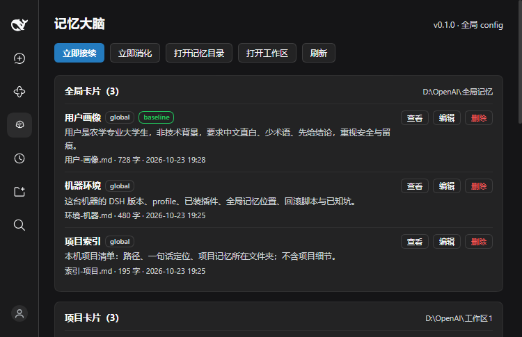

<p align="center">
  
</p>

<h1 align="center">dsh-brain · 记忆大脑</h1>

<p align="center">
  <b>给 DeepSeek Harness 的四层记忆插件</b><br>
  按需检索、自动接续、任务封存——让每个新会话都从「结论」开始，而不是从「历史」开始。
</p>

<p align="center">
  
  
  
  <a href="dsh-brain/1.1/README.md"></a>
</p>

---

## 它解决什么问题

| 痛点 | 常见做法 | 记忆大脑 |
|---|---|---|
| 会话越聊越长，每次请求都在为历史付费 | 手动开新对话，靠人复述 | 任务干完就 **封存**：上下文从 36 万 token 降到 1 万左右 |
| 记忆散落在聊天记录里，找不回来 | 全文塞进系统提示 | **四层卡片 + BM25 检索**，每轮只注入相关的 2 张 |
| 换个会话就「失忆」 | 复制粘贴摘要 | 自动接续 + 任务卡，新会话第一步就知道干到哪了 |
| 已有 sage-mem 记忆库不想迁移 | 重写迁移脚本 | 目录与卡片格式**完全沿用**，换插件不用动数据 |

一句话：**记忆是本体，会话是工作台。** 工作台用完就换，本体一直留着。

## 核心能力

### 四层记忆

| 层 | 位置 | 作用 |
|---|---|---|
| 全局 | `~/.sage-mem/memory/`（可用 `SAGE_MEM_DIR` 改） | 用户画像、机器环境、跨项目索引 |
| 项目 | `<工作区>/工作记忆/项目记忆/` | `00-概况` / `01-决定` / `02-坑` |
| 实时 | `<工作区>/工作记忆/实时记忆/当前任务.md` | 当前任务进展 |
| 日志 | `.../实时记忆/日志/` | 操作留痕、会话摘要，不参与注入 |

### 按需注入

会话首步注入画像全文与项目概况；之后每轮中文二元组 + 英文整词的 BM25，取 top-2、单卡 ≤600 字、每轮 ≤2400 字。0 命中就不注入。

### 自动接续

上下文 ≥80%、单轮 >150k token 或超过 60 轮时自动触发：写实时卡 → 建新会话 → 继承模型与权限 → 归档旧会话。不删会话、不代发消息。

### 任务封存（0.2.0）

任务收尾时 agent 调用 `task_seal`：写任务卡（≤800 字）+ 会话摘要（不限长度、不注入）→ 开新会话。
新会话首步直接带任务卡全文，一开口就能复述「干了什么、下一步是什么」。

### 侧栏面板

查看 / 编辑 / 删除卡片，调阈值与预算，一键「立即接续」「立即封存」。



## 快速开始

**前置**：DSH ≥ `0.2.1-rc.2`，Node ≥ 22.19。

```powershell
git clone https://github.com/yesterday06/dsh-brain.git
cd dsh-brain\dsh-brain\1.1
```

装进桌面 profile（先备份 `package.json`）：

```powershell
cd $env:USERPROFILE\.dsh\profiles\desktop
pnpm add link:<仓库路径>\dsh-brain\1.1
```

把 `"dsh-brain"` 加进 `package.json` 的 `dsh.profile.bundles`，重启 DSH。

> 桌面 profile 不要用 `dsh plugin --profile desktop` 安装，必须 `pnpm add` + 改 bundles。

## 配置

`%USERPROFILE%\.dsh\brain\settings.json`，面板改完立即生效：

```json
{
  "autopilot": true,
  "threshold": 80,
  "topK": 2,
  "maxChars": 600,
  "baselineChars": 1300,
  "summaryChars": 120,
  "maxRoundChars": 2400,
  "firstStepChars": 1500
}
```

| 环境变量 | 作用 |
|---|---|
| `SAGE_MEM_DIR` / `DSH_BRAIN_GLOBAL_DIR` | 全局记忆目录 |
| `DSH_BRAIN_STATE_DIR` | 状态、备份、日志目录（默认 `~/.dsh/brain`） |
| `DSH_BRAIN_DEBUG=1` | 高频调试日志 |

## 仓库结构

```
dsh-brain/               仓库（项目 → 版本）
└─ dsh-brain/            项目
   ├─ 1.0/               0.1.0：首个公开版
   └─ 1.1/               0.2.0：当前版（任务封存 + 会话摘要）
      ├─ src/            Host 与 Client 源码
      ├─ locale/         zh / en
      ├─ tests/          单元、接续、封存、回归、面板验证
      ├─ release/        打包产物与构建记录
      ├─ DESIGN.md       1.0 设计
      └─ DESIGN-1.1.md   任务封存设计
```

每个版本目录都是**完整可安装插件**：`package.json`、`src/`、`locale/`、`cordis.patch.yml`、`README.md`、`LICENSE`。

## 版本

| 目录 | 版本 | 日期 | 主要变化 |
|---|---|---|---|
| [1.0](dsh-brain/1.0/) | 0.1.0 | 2026-10-23 | 四层记忆、检索注入、自动接续、面板 |
| [1.1](dsh-brain/1.1/) | 0.2.0 | 2026-10-24 | `task_seal` 任务封存、会话摘要、5 个工具、首步任务卡注入 |

变更明细见 [CHANGELOG](dsh-brain/CHANGELOG.md)，详细文档见 [1.1/README](dsh-brain/1.1/README.md)。

## 设计文档

- [DESIGN.md](dsh-brain/1.1/DESIGN.md) —— 四层记忆、注入、接续
- [DESIGN-1.1.md](dsh-brain/1.1/DESIGN-1.1.md) —— 任务封存：为什么、任务卡结构、失败处理、成本
- [src/README.md](dsh-brain/1.1/src/README.md) —— 模块职责

## 开发与测试

```powershell
cd dsh-brain\1.1
node tests/unit-smoke.mjs      # 卡片存储 + 工具 + 注入链（11 项）
node tests/handoff-smoke.mjs   # 自动接续
node tests/seal-smoke.mjs      # 任务封存（51 项）
```

10 问回归对照：`tests/compare-10.mjs`，历史结果 `tests/p3-regression.txt`（10/10，sage-mem 基线 7/10）。

## 兼容性

- DSH：`>= 0.2.1-rc.2`（`package.json` 的 `dsh.compatibility` 已声明）
- 平台：Windows / macOS / Linux（纯 Node，无原生依赖）
- 与 sage-mem **不要同时启用**（双份注入、写冲突）；切换只改 `dsh.profile.bundles`

## 许可

[MIT](dsh-brain/1.1/LICENSE)

---

<details>
<summary>English</summary>

**dsh-brain** is a memory plugin for DeepSeek Harness. It keeps a four-layer markdown card store
(global / project / live / log), injects only relevant cards each turn via BM25 (Chinese bigrams + English
words), hands off long sessions automatically, and — new in 0.2.0 — seals a finished task into a compact
card plus a full session summary before opening a clean session. Card format and directory layout are
compatible with `sage-mem`, so existing memory stores work without migration.

</details>
